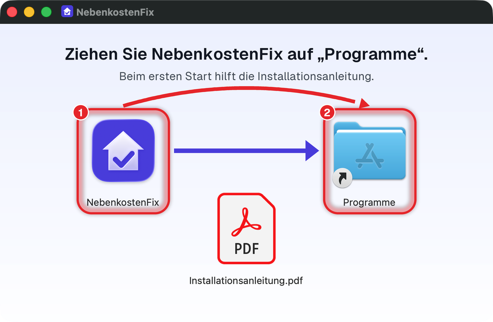
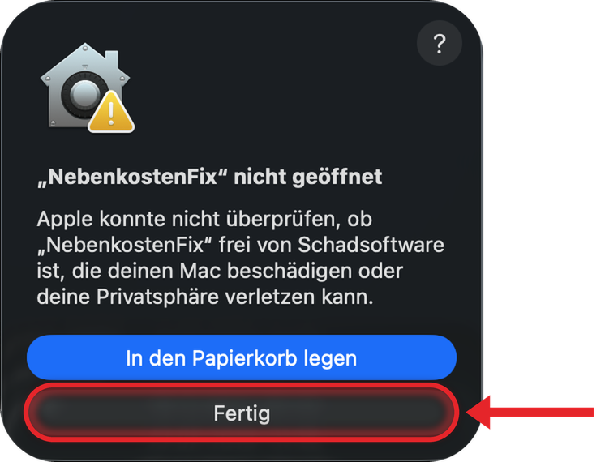
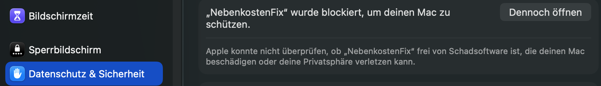
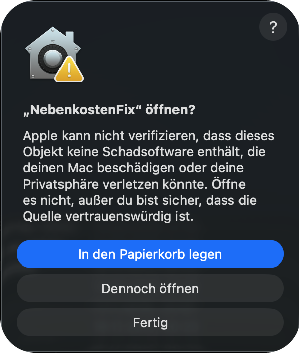
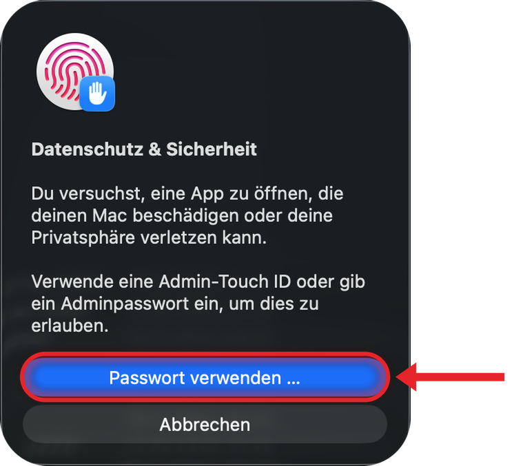
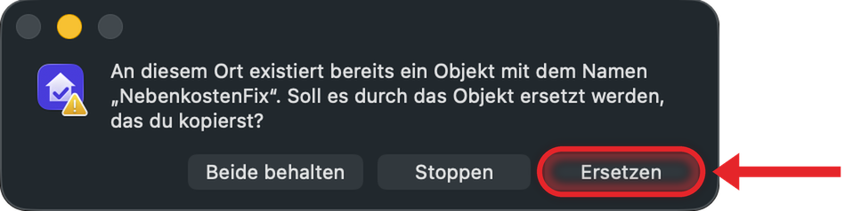

# NebenkostenFix auf dem Mac installieren

Diese Anleitung führt Sie Schritt für Schritt durch die Installation der Mac-App. Sie brauchen
dafür keine Vorkenntnisse. Beim ersten Start fragt macOS mehrmals nach, das ist normal. Die
Bilder unten zeigen, was Sie dabei sehen.

## 1. Was Sie brauchen

- Einen Mac mit Apple-Chip (M1 oder neuer). Welchen Chip Ihr Mac hat, steht im Apple-Menü
  unter „Über diesen Mac“.
- macOS 15 oder neuer.
- Das Passwort eines Administrators für diesen Mac. Meist ist das Ihr eigenes Anmeldepasswort.
  Wenn Sie kein Administrator sind, bitten Sie jemanden mit diesen Rechten um Hilfe.

## 2. Herunterladen

Laden Sie die Datei `NebenkostenFix-…-macOS-arm64.dmg` herunter. Die Punkte stehen für die
Versionsnummer. Sie landet im Ordner „Downloads“.

## 3. Installieren

1. Öffnen Sie die heruntergeladene Datei mit einem Doppelklick. Es öffnet sich ein Fenster
   mit NebenkostenFix und dem Ordner „Programme“.
2. Ziehen Sie **NebenkostenFix** (auf dem Bild rot mit 1 markiert) auf **Programme** (2).
3. Schließen Sie das Fenster. Klicken Sie im Finder in der Seitenleiste neben „NebenkostenFix“
   auf das Auswerfen-Symbol.

Starten Sie die App immer aus „Programme“, nicht aus dem Fenster der heruntergeladenen Datei.

## 4. Der erste Start

NebenkostenFix ist kostenlos und deshalb nicht bei Apple registriert. macOS kann die App daher
nicht selbst prüfen und fragt beim ersten Start nach. Das geht in vier Schritten. Auf den
Bildern ist rot markiert, wo Sie klicken.

**Schritt 1:** Öffnen Sie „Programme“ und starten Sie NebenkostenFix mit einem Doppelklick.
macOS meldet, dass die App nicht geöffnet wurde. Klicken Sie auf **Fertig**, nicht auf „In den
Papierkorb legen“.

**Schritt 2:** Öffnen Sie im Apple-Menü die **Systemeinstellungen** und dort links
**Datenschutz & Sicherheit**. Scrollen Sie rechts nach unten bis zum Abschnitt „Sicherheit“.
Bei „NebenkostenFix wurde blockiert“ klicken Sie auf **Dennoch öffnen**. Den Knopf zeigt
macOS nur etwa eine Stunde lang nach dem Startversuch. Ist er weg, starten Sie die App noch
einmal wie in Schritt 1.

**Schritt 3:** macOS fragt noch einmal nach. Klicken Sie auf **Dennoch öffnen**.

**Schritt 4:** Bestätigen Sie mit Touch ID oder mit dem Passwort eines Administrators
(„Passwort verwenden …“).

Danach startet NebenkostenFix. Ab jetzt öffnet macOS die App ohne Rückfrage, wie jede andere.

Die App selbst fragt zuerst: „Wo sollen Ihre Daten liegen?“ Klicken Sie auf **Auf diesem
Rechner arbeiten**. Dann bleiben Ihre Daten auf Ihrem Mac. Den anderen Weg, einen eigenen
Server, brauchen nur wenige (siehe Abschnitt 9). Danach zeigt die App den Hinweis „Bevor es
losgeht“. Lesen Sie ihn und klicken Sie auf **Verstanden**. Die Frage nach dem Ort Ihrer Daten
kommt bei jedem Start wieder, bis Sie Ihre erste Immobilie angelegt haben.

## 5. Eine neue Version installieren

Laden Sie die neue Datei herunter und installieren Sie sie wie in Abschnitt 3. Der Finder
fragt, ob er die vorhandene App ersetzen soll. Klicken Sie auf **Ersetzen**.

Weil jede Version eine neue, ungeprüfte Datei ist, fragt macOS beim nächsten Start wieder nach.
Gehen Sie dann wie in Abschnitt 4 vor. Ihre Daten bleiben dabei erhalten.

## 6. Wo Ihre Daten liegen

NebenkostenFix speichert alles in einem Ordner auf Ihrem Mac:
`~/Library/Application Support/NebenkostenFix/Daten`. Nichts davon geht an einen Server von
NebenkostenFix.

So öffnen Sie den Ordner:
- in der App über das Menü „Hilfe“ → „Datenordner anzeigen“, oder
- im Finder über „Gehe zu“ → „Gehe zu Ordner …“. Geben Sie dort den Pfad oben ein.

Der Ordner liegt bewusst nicht in „Dokumente“. Diesen Ordner gleicht iCloud oft ab, und eine
Datenbank kann dabei Schaden nehmen.

## 7. Neu anfangen

Wenn Sie mit leeren Daten neu beginnen möchten:

1. Legen Sie vorher eine Sicherung an (in der App unter Einstellungen → Datensicherung).
2. Beenden Sie NebenkostenFix mit dem Menü „NebenkostenFix“ → „NebenkostenFix beenden“ oder
   mit Cmd-Q.
3. Öffnen Sie im Finder über „Gehe zu“ → „Gehe zu Ordner …“ den Ordner
   `~/Library/Application Support/NebenkostenFix`. Legen Sie darin den Ordner `Daten` in den
   Papierkorb.

Beim nächsten Start beginnt NebenkostenFix mit leeren Daten.

## 8. NebenkostenFix entfernen

Beenden Sie die App und legen Sie sie aus „Programme“ in den Papierkorb. Ihre Daten bleiben
dabei erhalten. Wenn Sie auch die Daten entfernen möchten, legen Sie zusätzlich den Ordner
`~/Library/Application Support/NebenkostenFix` in den Papierkorb. Sichern Sie vorher, was Sie
behalten möchten.

## 9. Mit einem Server verbinden (nur wenn Sie das möchten)

**Ihre Daten bleiben auf Ihrem Mac.** So arbeitet NebenkostenFix von Haus aus. Nichts davon
verlässt Ihren Mac, solange Sie sich nicht selbst mit einem Server verbinden.

Einen Server brauchen Sie nur in einem Fall: Sie möchten von mehreren Computern aus mit
denselben Daten arbeiten. Dafür läuft NebenkostenFix bei Ihnen zu Hause auf einem eigenen
Gerät, zum Beispiel auf einer Synology. Das richten Sie selbst ein oder jemand, der sich damit
auskennt. Wie das geht, steht auf der
[Projektseite unter „Synology“](https://github.com/Nerbry72/NebenkostenFix#synology-ohne-kommandozeile).
Es muss Ihr eigener Server sein, fremde Server gehen nicht.

Wenn Ihr Server läuft:

1. Beim ersten Start klicken Sie auf **Mit einem NebenkostenFix-Server verbinden**. Später
   geht es über das Menü „Ablage“ → „Mit einem Server verbinden …“ oder in der App über
   **Einstellungen → Datensicherung**.
2. Tragen Sie in der Karte **Mit einem Server verbinden** die **Adresse des Servers** ein. Die
   Adresse bekommen Sie von dem, der den Server eingerichtet hat, zum Beispiel
   `http://diskstation:6060`. Schreiben Sie sie genau so ab, auch mit `http://` am Anfang.
3. Setzen Sie den Haken bei „Ich habe verstanden, dass ich danach mit den Daten auf dem Server
   arbeite.“ und klicken Sie auf **Verbinden**. Die App startet neu.
4. Melden Sie sich mit Ihrem Namen und Passwort für den Server an. Das fragt die App bei jedem
   Start.

Oben im Fenster steht jetzt „verbunden mit …“. So sehen Sie immer, dass Sie mit den Daten auf
dem Server arbeiten. Ihre Daten vom Mac kommen dabei nicht auf den Server.

Zurück zu Ihren Daten auf dem Mac geht es über das Menü „Ablage“ → „Auf diesem Rechner
arbeiten …“. Dann ist alles wieder so, wie Sie es auf dem Mac verlassen haben.
